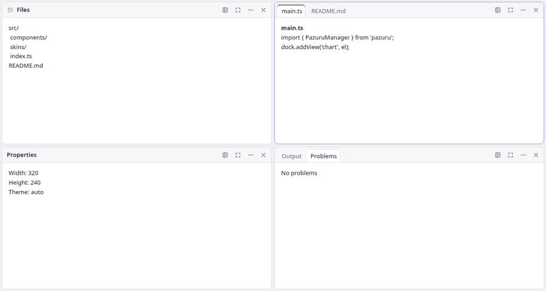
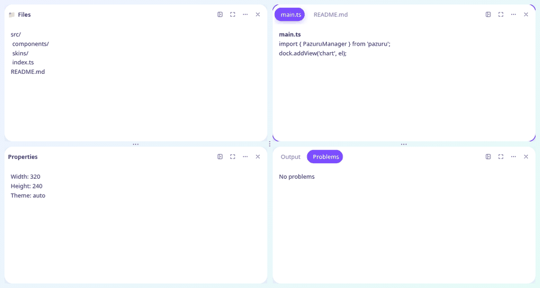
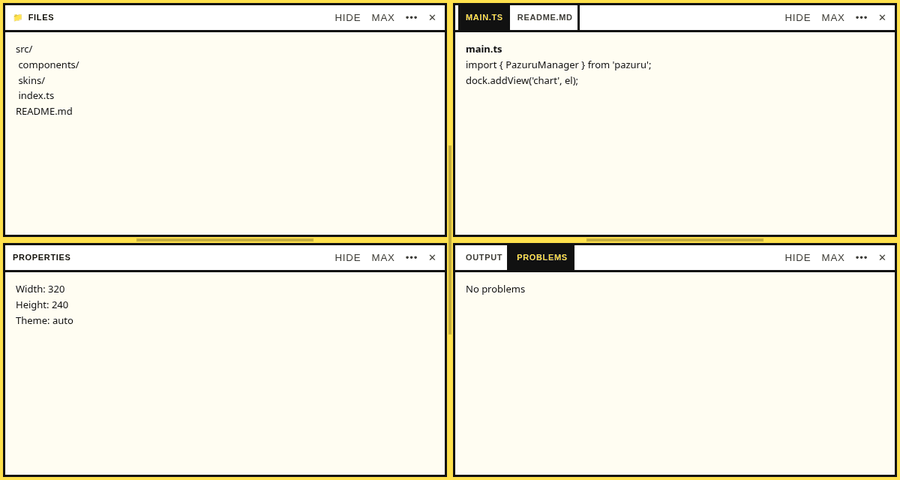
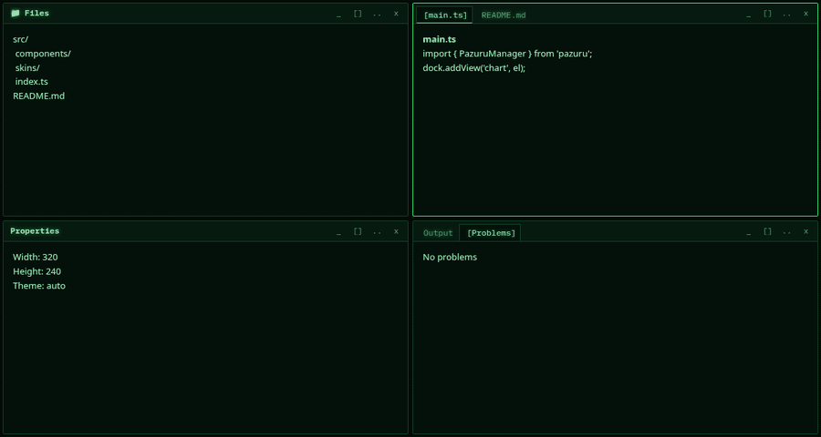

# dockorama

A docking layout manager as a framework-agnostic web component, built with [Lit](https://lit.dev).
Split, tab, float, auto-hide, zoom and rearrange views by drag and drop or keyboard — with undo/redo,
workspaces, persistence, pop-out windows, a command palette and a layout minimap.

**Docs & live examples:** https://davidhanson90.github.io/dockorama/ ·
**Trading desk example:** [in the docs](https://davidhanson90.github.io/dockorama/#/examples/trading) or
[full page](https://davidhanson90.github.io/dockorama/trading.html)

| Default | Nimbus |
|---|---|
|  |  |
| **Ledger** | **Phosphor** |
|  |  |

## Getting started

```bash
npm install dockorama
```

```html
<dockorama-manager id="dock" style="display: block; height: 600px"></dockorama-manager>
<script type="module" src="./main.ts"></script>
```

```ts
import "dockorama";                      // registers <dockorama-manager> and its parts
import "dockorama/skins/nimbus";         // optional: switch every dock to the Nimbus skin
import type { DockoramaManager, DockoramaModel } from "dockorama";

const dock = document.querySelector<DockoramaManager>("#dock")!;

// Views from an element, a string, or a lazy factory
const chart = document.createElement("canvas");
dock.addView("chart", chart, { title: "Chart", icon: "📈" });
dock.addView("notes", "Plain text is padded for you", { title: "Notes", at: { near: "chart", zone: "right" } });
dock.addView("log", () => document.createElement("pre"), { title: "Log", at: { near: "notes", zone: "into" } });

// Typed events (via HTMLElementEventMap)
dock.addEventListener("dockorama-change", (e) => console.log("layout changed:", e.detail.reason));
dock.addEventListener("dockorama-beforeclose", (e) => {
  if (e.detail.id === "chart" && !confirm("Close the chart?")) e.preventDefault();
});

// Save and restore the layout
const saved: DockoramaModel = dock.snapshot();
localStorage.setItem("layout", JSON.stringify(saved));
dock.restore(JSON.parse(localStorage.getItem("layout")!) as DockoramaModel);
```

Notes:

- Import `dockorama` for its side effect (it defines the custom elements). A type-only import is removed by
  bundlers, so keep the plain `import "dockorama";` line.
- The default skin is applied automatically. Skins and the skin API live under `dockorama/skins`
  (`import { defaultSkin, useSkin, overrideSkin } from "dockorama/skins"`); importing `dockorama/skins/<name>`
  (`default`, `nimbus`, `ledger`, `phosphor`) makes that skin the page-wide one.
- String content is rendered as text in a padded `.dockorama-text` box (`--dk-text-padding`); element content is
  used as-is. A function is called the first time the view is shown.
- Add `storage-key="my-app"` to the element to save and reload the layout automatically.

You can also declare views in markup with `data-view` children and set a full layout with `createModel`:

```html
<dockorama-manager id="dock" style="height: 600px">
  <div data-view="files">File tree…</div>
  <div data-view="main">Editor…</div>
  <div data-view="log">Output…</div>
</dockorama-manager>
<script type="module">
  import { createModel, row, column, stack, docs } from "dockorama";
  document.getElementById("dock").model = createModel(
    { files: { title: "Files" }, main: { title: "main.ts" }, log: { title: "Output" } },
    row([stack(["files"]), column([docs(["main"]), stack(["log"])], [3, 1])], [1, 4])
  );
</script>
```

See [docs/API-DESIGN.md](docs/API-DESIGN.md) for the model and API.

### Framework wrappers

React:

```tsx
import { useRef } from "react";
import { DockoramaLayout } from "dockorama/react";
import type { DockoramaManager } from "dockorama";

export function App() {
  const ref = useRef<DockoramaManager>(null);
  return (
    <DockoramaLayout ref={ref} storageKey="my-app" style={{ height: 600 }}
      onLayoutChange={({ reason }) => console.log(reason)}
      onBeforeClose={(e) => { if (e.detail.id === "files") e.preventDefault(); }}>
      <div data-view="files">Files</div>
    </DockoramaLayout>
  );
}
```

Vue 3:

```vue
<script setup lang="ts">
import { ref } from "vue";
import { DockoramaLayout } from "dockorama/vue";
const layout = ref();
</script>
<template>
  <DockoramaLayout v-model:model="layout" storage-key="my-app" @layout-change="(d) => console.log(d.reason)">
    <div data-view="files">Files</div>
  </DockoramaLayout>
</template>
```

Angular (standalone):

```ts
import { Component } from "@angular/core";
import { DockoramaLayoutComponent } from "dockorama/angular";

@Component({
  selector: "app-root",
  standalone: true,
  imports: [DockoramaLayoutComponent],
  template: `<dockorama-layout [model]="layout" (layoutChange)="layout = $event.model">
    <div data-view="files">Files</div>
  </dockorama-layout>`,
})
export class AppComponent { layout?: import("dockorama").DockoramaModel; }
```

Svelte:

```svelte
<script lang="ts">
  import "dockorama";
  import { dockorama } from "dockorama/svelte";
</script>
<dockorama-manager use:dockorama={{ storageKey: "my-app", on: { change: (d) => console.log(d.reason) } }}>
  <div data-view="files">Files</div>
</dockorama-manager>
```

## Features

| Area | Feature | Description |
|---|---|---|
| Layout | Splits | Nested rows and columns with draggable splitters, snapping, size limits, fixed sizes and collapse |
| Layout | Document area | A central area for documents, kept apart from tool panes |
| Layout | Maximise | Zoom any pane to fill the dock and back |
| Layout | Multiple docks | Several managers on one page, each with its own state; views can move between them (`drag-group`) |
| Tabs | Tab groups | Tabs with icons, overflow scrolling and reordering |
| Tabs | Pinned and preview tabs | Sticky tabs that stay at the front, and a reusable preview tab |
| Tabs | Unsaved changes | Dirty dot on the tab and an async confirm before closing |
| Tabs | Tab menu | Right-click / Shift+F10 menu with close others, float, pin and more, customisable |
| Tabs | Large tab lists | Virtualised tab strip for very many tabs |
| Floating / pop-out | Floating windows | Detach views into movable, resizable floating windows |
| Floating / pop-out | Pop-out windows | Move views into real browser windows, several views per window, remembered in saved layouts |
| Auto-hide | Edge rails | Stow panes to an edge; they slide out as flyouts and can be pinned back |
| Drag & drop | Drop guides | Drop beside, above, below or into panes, onto dock edges, splitter gaps and empty document areas |
| Drag & drop | Cancel | Esc cancels a drag; touch dragging is supported |
| Keyboard / a11y | Keyboard docking | Alt+M moves a view step by step with screen-reader announcements |
| Keyboard / a11y | Shortcuts and ARIA | Tab cycling, neighbour focus, full roles and labels, right-to-left support, translatable labels |
| Persistence / workspaces | Snapshot and restore | `snapshot()` / `restore()` the whole layout as plain JSON |
| Persistence / workspaces | Auto-save | `storage-key` saves to and reloads from local storage |
| Persistence / workspaces | Workspaces | Named layouts with the `Workspaces` class |
| Persistence / workspaces | Versioning | Layout versions with migrations, validation and `dockorama-layoutissue` |
| Persistence / workspaces | Retained views | `retain="active"` keeps hidden views alive instead of re-creating them |
| Events | Typed events | Change, focus, show/hide, close, float, dock, stow, pin, pop-out, collapse, drag, resize and transfer events, typed through `HTMLElementEventMap` |
| Events | Vetoable events | Cancel `beforeadd`, `beforeclose`, `beforemove`, `dragstart` and menu commands with `preventDefault()` |
| Skins / theming | Skins | Default, Nimbus, Ledger and Phosphor skins from `dockorama/skins/<name>` |
| Skins / theming | Template overrides | Replace any of the typed part templates or add CSS page-wide (`overrideSkin`) or per dock (`skinPatch`) |
| Skins / theming | Themes | Light, dark and auto themes, styled through `--dk-*` CSS custom properties |
| Wrappers | Frameworks | React, Vue 3, Angular and Svelte wrappers as optional subpath exports |
| Extras | Minimap | `<dockorama-minimap for="id">`, a live overview of the layout you can click to navigate |
| Extras | Command palette | Find views and run commands from the keyboard (`openPalette()`) |
| Extras | Undo / redo | `undo()` / `redo()` for every layout change |
| Extras | One-call views | `addView` with an element, text or lazy factory |

## Components

`<dockorama-manager>` owns the layout model and renders one Lit custom element per UI piece:
`<dockorama-split>`, `<dockorama-gutter>`, `<dockorama-stack>`, `<dockorama-docs>`, `<dockorama-tabstrip>`, `<dockorama-tab>`,
`<dockorama-toolbar>`, `<dockorama-view>`, `<dockorama-window>`, `<dockorama-drop-guide>`, `<dockorama-rail>`, `<dockorama-flyout>`,
`<dockorama-menu>` and `<dockorama-palette>`, plus the standalone `<dockorama-minimap>`. Source lives in `src/components/`, one
file per element with a colocated `*.spec.ts`. Several managers can share a page; give each its own `storage-key`.

## Skins

Every visual part renders through a named, typed template from a skin. The built-in skin is applied automatically;
import another to change the look of every dock, or set one per dock:

```js
import "dockorama/skins/nimbus";            // or ledger, phosphor
import { useSkin, overrideSkin, extendSkin } from "dockorama/skins";
overrideSkin({ templates: { "tab-label": (c) => html`<b>${c.title}</b>` } });   // one part, page-wide
dock.skinPatch = { css: ".tab { font-style: italic }" };                       // one dock
```

See the Skins guide on the docs site for every template key and its context.

## Events

All events are typed `CustomEvent`s on `<dockorama-manager>` (bubbling, composed): layout, view lifecycle
(`dockorama-beforeadd`, `-viewshow`, `-viewhide`, `-close`, `-viewremove`), state (`-float`, `-dock`, `-stow`, `-pin`,
`-popout`, `-collapse` and their pairs), drag (`-dragstart`, `-dragover`, `-drop`), resize (`-resize`, `-resizing`)
and menu commands (`-command`). See the Events guide on the docs site.

## Framework wrappers

Optional subpath exports; each framework is an optional peer dependency.

| Import | Export |
|---|---|
| `dockorama/react` | `<DockoramaLayout model onLayoutChange …>` (ref = element) |
| `dockorama/vue` | `<DockoramaLayout v-model:model …>` |
| `dockorama/angular` | `DockoramaLayoutComponent` (`<dockorama-layout [model] (layoutChange)>`), standalone |
| `dockorama/svelte` | `use:dockorama={{ model, on: { change } }}` action |

## Development

```bash
npm install
npm start              # build + docs site dev server
npm run build:verify   # naming guard, lint, type checks, unit tests with coverage, build
npm run test:e2e       # Playwright behaviour suite (add :smoke for the fast subset)
npm run test:visual    # screenshot baselines per skin (Linux; see docs/testing.md)
```

Some tests (the Angular wrapper spec, the docs site and e2e) run against the compiled `dist/`. `npm test` and
`npm run test:coverage` build automatically when `dist/` is missing or older than `src/` (`scripts/ensure-build.mjs`),
and `npm run test:e2e` builds the docs site first, so a fresh clone needs only `npm ci && npm test`. Run
`npm run build` yourself after switching branches if a test reports a missing `dist/` file. The naming and API
guards use the optional private records folder (`DOCKORAMA_RECORDS`) and skip when it is absent.

## Testing

Unit tests use Vitest; behaviour and visual regression tests use Playwright. The strategy, how to run the suites, how to update
screenshot baselines and how to add tests are in [docs/testing.md](docs/testing.md).

## License

MIT
